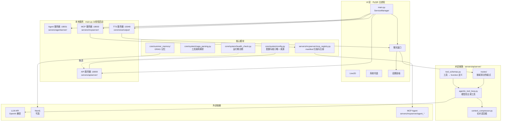

# NagaAgent

[简体中文](README.md)|[繁體中文](README_zh-Hant.md)|[English](README_en.md)


---

> ## 关于本仓库
>
> 这是 [**RTGS2017/NagaAgent**](https://github.com/RTGS2017/NagaAgent) 的 **fork**，
> 非上游官方仓库。原始项目版权归原作者 **柏斯阔落** 所有，遵循仓库内的
> [NagaAgent License](LICENSE)。
>
> **本 fork 的改动方向**（上游没有）：界面与架构重构。
>
> | 方向 | 内容 |
> |---|---|
> | 主题系统 | `ui/styles/tokens.py` 统一色值，两套主题：少女前线·战术（深）/ 莱茵生命·档案（浅） |
> | 设置页 | 声明式重写（`ui/pages/settings/`）：`schema.py` 一行声明 = 一个设置项，UI 自动生成 |
> | 聊天控制器 | 967 行单一类拆成 3 个 mixin（列表 / 流式 / 表情）+ 编排主类 |
> | 视觉 | 顶栏、页脚、消息卡片、Live2D 配置弹窗全部重绘，直角化设计 |
> | 工程 | `scripts/audit.py` 项目体检、`faulthandler` 崩溃日志、端口从 8000 段迁至 18000 段 |
>
> **同步上游**：
> ```bash
> git remote add upstream https://github.com/RTGS2017/NagaAgent.git
> git fetch upstream && git merge upstream/main
> ```
>
> 改动集中在 `ui/` 与少量 `core/`，同步上游时冲突面主要在 `ui/`。

> **这是一个开发者工具** 需要你自己具备 Python 3.11 环境与命令行基础
> 本项目不提供图形化安装包或整合包 <del>（等我有时间再弄这种东西）</del>

## 目录

- [介绍](#介绍)
- [系统架构](#系统架构)
  - [服务与端口](#服务与端口)
  - [对话与工具调用](#对话与工具调用)
  - [运行期诊断](#运行期诊断)
- [部署运行](#部署运行)
  - [环境要求](#环境要求)
  - [1. 安装依赖](#1-安装依赖)
  - [2. 配置](#2-配置)
  - [3. 启动](#3-启动)
- [故障排除](#故障排除)
  - [端口起不来但 netstat 看不到占用](#端口起不来但-netstat-看不到占用)
- [依赖说明](#依赖说明)
- [许可证](#许可证)
- [贡献](#贡献)

## 介绍

NagaAgent 是一个基于 PyQt5 的桌面智能对话助手，围绕四个本地服务 + 一套 MCP 工具展开：

- **流式对话**：LLM 流式输出，**模型自主调用工具**（原生 function calling）
- **MCP 工具系统**：以 `agent-manifest.json` 声明式注册，进程内调度
- **知识图谱记忆（GRAG）**：五元组抽取与检索，默认 Kuzu 嵌入式后端，无需额外服务
- **实时语音**：语音输入 + TTS 输出
- **桌面形态**：Live2D 虚拟形象、系统托盘、设置面板

---

## 系统架构



### 服务与端口

端口**全部来自 `config.json`**，由 `core/system/config.py` 统一解析：

| 服务 | 端口 | 配置节 | 代码位置 |
|---|---|---|---|
| API 服务器 | 18000 | `api_server.port` | `servers/apiserver/api_server.py` |
| Agent 服务器 | 18001 | `agentserver.port` | `servers/agentserver/agent_server.py` |
| MCP 服务器 | 18003 | `mcpserver.port` | `servers/mcpserver/mcp_server.py` |
| TTS 服务器 | 15048 | `tts.port` | `core/voice/output/server.py` |
| ASR 服务器 | 15060 | `asr.port` | 语音输入 |

> 读取方式统一为 `core.system.config.get_current_port("<name>")`，缺省值仅作兜底，不再散落硬编码

### 对话与工具调用

```
用户消息 → 带工具定义调模型
         ├ 没有 tool_calls → 结束，内容流式返回
         └ 有 tool_calls   → 执行工具 → 结果塞回对话 → 再调模型（最多 5 轮）
```

工具定义由 `servers/apiserver/tool_schemas.py` 从
`servers/mcpserver/*/agent-manifest.json` 生成

| 能力 | 开关 | 默认 |
|---|---|---|
| 模型自主调用工具 | `api.function_calling_enabled` | 开 |
| 长对话自动压缩 | 自动（超过 10 万 token） | 开 |
| 工具路由 | `api.intent_router_enabled` | 关 |

关闭、无 MCP 服务或工具表构建失败时，自动退回单轮流式对话

### 运行期诊断

`system_checker.py` 检查能否启动；`health_check.py` 检查各服务是否连通

```bash
python -m core.system.health_check      # 非全绿时退出码 1
curl http://127.0.0.1:18000/health/full  # 单次 2–3 秒
```

启动后由后台线程延迟 6 秒执行一次，只写日志

---

## 部署运行

### 环境要求

- Python **3.11**（`>=3.11,<3.12`）
- 推荐使用 [uv](https://docs.astral.sh/uv/) 管理依赖

### 1. 安装依赖

```bash
uv sync
```

也可以用脚本或手动安装：

```bash
python scripts/setup.py         # 跨平台；Windows 用 scripts\setup.bat
python -m venv .venv            # 手动
.\.venv\Scripts\activate
pip install -r requirements.txt
```

> 国内网络建议使用镜像源：
> `set UV_DEFAULT_INDEX=https://pypi.tuna.tsinghua.edu.cn/simple`

> **浏览器类 Agent 需要额外下载 Chromium**（约 150 MB）：
> `uv run playwright install chromium`
> 不做这一步不影响主程序启动，只是「网页解析 / 浏览器 Agent」不可用。

### 2. 配置

复制模板，填入你的 API Key：

```bash
cp config.json.example config.json      # Windows: copy config.json.example config.json
```

```json
{
  "api": {
    "api_key": "你的api_key",
    "base_url": "https://api.deepseek.com",
    "model": "deepseek-flash"
  }
}
```

**其余配置项模板里都有行内注释**，按需修改即可，常用几项：

| 配置项 | 说明 |
|---|---|
| `grag.graph_backend` | `kuzu`（默认，零依赖）/ `neo4j` / `sqlite` |
| `live2d.enabled` | 是否显示 Live2D 虚拟形象 |
| `system.voice_enabled` | 是否启用语音播报 |
| `ui.font_family` | 聊天字体（须是系统已安装的字体） |

也可以在应用内的**设置面板**里改，保存后写回 `config.json`

> ⚠️ Kuzu 是**单写入者**模型：**不要同时运行两个 NagaAgent 实例**

> 知识图谱数据默认存在 `data/graph.kuzu`，**删掉这个文件即可清空全部记忆**
> 想换位置就改 `grag.kuzu_db_path`

> ⚠️ 填好 API Key 的 `config.json` 不要分享或提交到公开仓库 —— 它等同于你的账户凭据

#### 使用独立的 Neo4j（可选）

本地已有 Neo4j 实例时：

```json
{
  "grag": {
    "enabled": true,
    "graph_backend": "neo4j",
    "neo4j_uri": "neo4j://127.0.0.1:7687",
    "neo4j_user": "neo4j",
    "neo4j_password": "你的密码"
  }
}
```

### 3. 启动

```bash
python main.py
```

或使用脚本：`scripts\start.bat`（Windows）/ `./scripts/start.sh`（Linux / macOS）

启动后四个服务分别在 18000 / 18001 / 18003 / 15048 端口，可改 `config.json` 中对应节

#### 命令行参数

```bash
python main.py --check-env --force-check   # 完整环境检测
python main.py --quick-check               # 快速检测
python main.py --check-api                 # 只校验 API Key / 端点 / 模型
```

---

## 故障排除

**先跑一次诊断**，它会逐项探活服务端口、检查依赖与目录可写性，
大多数「跑起来了但某功能不工作」的问题能直接定位：

```bash
python -m core.system.health_check        # 或 curl http://127.0.0.1:18000/health/full
```

| 现象 | 处理 |
|---|---|
| Python 版本不符 | 确认使用 Python 3.11 |
| 提示 API Key 无效(401) | 修改 `config.json` 的 `api.api_key`；用 `python main.py --check-api` 校验 |
| 端口被占用 | 检查 18000 / 18001 / 18003 / 15048，或在 `config.json` 中改端口 |
| **提示端口被占用，但 `netstat` 查不到任何占用** | Windows 保留段问题，见下方说明 |
| 提示「Kuzu 数据库被占用」 | 确认没有第二个 NagaAgent 实例在运行 |
| 记忆时有时无 | 见上一条；或把 `grag.graph_backend` 设为 `sqlite` |
| Neo4j 连接失败 | 仅在 `graph_backend` 设为 `neo4j` 时相关；改回 `kuzu` 即可免服务 |
| 浏览器 Agent 不可用 | 该功能需单独安装 SDK 与 Chromium，见下方依赖说明 |
| 语音输入用不了 | 需要一个真实的 DashScope API key，或本地跑 FunASR 服务；不影响 TTS |

### 端口起不来但 netstat 看不到占用

Windows 上 Hyper-V / WSL / Docker 的 `winnat` 服务会**随机保留若干端口段**，
落在保留段里的端口普通程序**无法绑定**，报 `WinError 10013`，
而且 `netstat` 里看不到任何套接字 —— 表现为「端口明明是空闲的却起不来」
保留段每次重启会重新随机，所以这个问题是**间歇性**的

查当前保留段：

```bat
netsh int ipv4 show excludedportrange protocol=tcp
```

临时修复（需管理员权限）：

```bat
net stop winnat
:: 启动 NagaAgent
net start winnat

:: 或永久把端口排除出动态分配
netsh int ipv4 add excludedportrange protocol=tcp startport=15048 numberofports=1 store=persistent
```

---

## 依赖说明

依赖全部在 `pyproject.toml` / `requirements.txt` 中直接声明：

| 类别 | 包 |
|---|---|
| 桌面界面 | `PyQt5` |
| 模型调用 | `openai`、`requests`、`aiohttp` |
| 服务框架 | `fastapi`、`uvicorn`、`mcp` |
| 配置校验 | `pydantic`、`PyYAML` |
| 图存储 | `kuzu`（默认后端）；`py2neo` / `neo4j`（仅 neo4j 后端需要） |
| 语音 / Live2D | `live2d-py`、`sounddevice`、`onnxruntime` |
| 浏览器自动化 | `playwright`、`crawl4ai` |

> **浏览器主 Agent 的完整能力需要额外安装**：`agent_playwright_master/playwright.py`
> 依赖 OpenAI Agents SDK（`openai-agents`），而它要求的 `openai>=3.0.0` 与
> `langchain-openai` 的 `openai<3.0.0` 冲突，因此不在默认依赖中
> 需要时单独安装，并执行 `playwright install chromium`

---

## 许可证

[NagaAgent License](LICENSE)

## 贡献

欢迎创建 Issue 和 Pull Request
