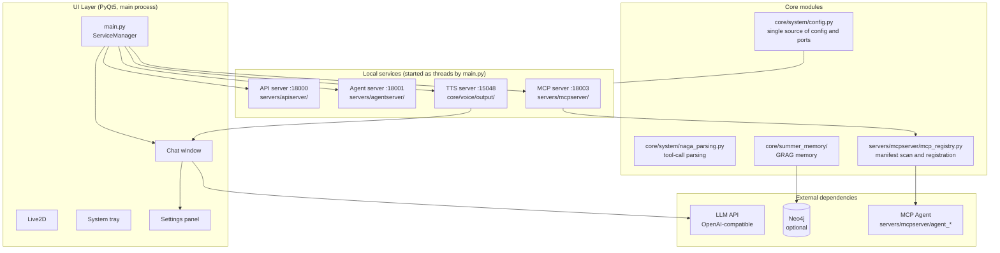

# NagaAgent

[简体中文](README.md)|[繁體中文](README_zh-Hant.md)|[English](README_en.md)


---

> ## About this repository
>
> This is a **fork** of [**RTGS2017/NagaAgent**](https://github.com/RTGS2017/NagaAgent),
> not the upstream official repository. Original copyright belongs to the author
> **柏斯阔落 (BaSiKuoLuo)**, licensed under the [NagaAgent License](LICENSE).
>
> **What this fork changes** (not in upstream): UI and architecture refactor.
>
> | Area | Change |
> |---|---|
> | Theming | `ui/styles/tokens.py` centralises every colour; two themes — Girls' Frontline Tactical (dark) / Rhine Lab Archive (light) |
> | Settings | Rewritten declaratively (`ui/pages/settings/`): one line in `schema.py` = one setting, the UI builds itself |
> | Chat controller | A 967-line god object split into 3 mixins (list / stream / emotion) + an orchestrating class |
> | Visuals | Header, footer, message cards and the Live2D config dialog all redrawn, squared-off design |
> | Engineering | `scripts/audit.py` project health check, `faulthandler` crash logs, ports moved from 8000s to 18000s |
>
> **Syncing upstream**:
> ```bash
> git remote add upstream https://github.com/RTGS2017/NagaAgent.git
> git fetch upstream && git merge upstream/main
> ```
>
> Changes are concentrated in `ui/` plus a little `core/`; merge conflicts will mostly be in `ui/`.

> **This is a developer tool.** You need Python 3.11 and basic command-line skills.
> There is no graphical installer or bundled all-in-one package <del>(I'll get to it when I have time).</del>

## Contents

- [Introduction](#introduction)
- [Architecture](#architecture)
  - [Services and Ports](#services-and-ports)
  - [Chat and Tool Calling](#chat-and-tool-calling)
  - [Runtime Diagnostics](#runtime-diagnostics)
- [Deployment and Running](#deployment-and-running)
  - [Requirements](#requirements)
  - [1. Install Dependencies](#1-install-dependencies)
  - [2. Configuration](#2-configuration)
  - [3. Start](#3-start)
- [Troubleshooting](#troubleshooting)
  - [Port unavailable even though netstat shows nothing](#port-unavailable-even-though-netstat-shows-nothing)
- [Dependencies](#dependencies)
- [License](#license)
- [Contributing](#contributing)

## Introduction

NagaAgent is a PyQt5 desktop AI assistant built around four local services and a set of MCP tools:

- **Streaming chat**: streaming LLM output, with the **model calling tools on its own** (native function calling)
- **MCP tool system**: declarative registration via `agent-manifest.json`, scheduled in-process
- **Knowledge graph memory (GRAG)**: quintuple extraction and retrieval; Kuzu embedded backend by default, no extra service required
- **Voice**: speech input and TTS output
- **Desktop experience**: Live2D avatar, system tray, settings panel

## Architecture



### Services and Ports

Ports **all come from `config.json`**, resolved centrally by `core/system/config.py`:

| Service | Port | Config section | Code |
|---|---|---|---|
| API server | 18000 | `api_server.port` | `servers/apiserver/api_server.py` |
| Agent server | 18001 | `agentserver.port` | `servers/agentserver/agent_server.py` |
| MCP server | 18003 | `mcpserver.port` | `servers/mcpserver/mcp_server.py` |
| TTS server | 15048 | `tts.port` | `core/voice/output/server.py` |
| ASR server | 15060 | `asr.port` | voice input |

> Read them with `system.config.get_current_port("<name>")`; the defaults are only a fallback.

---

### Chat and Tool Calling

```
User message -> call model with tool definitions
              |- no tool_calls -> done, stream the content back
              |- tool_calls    -> execute -> feed results back -> call model again (max 5 rounds)
```

Tool definitions are generated by `servers/apiserver/tool_schemas.py` from
`servers/mcpserver/*/agent-manifest.json`.

| Capability | Switch | Default |
|---|---|---|
| Model calls tools on its own | `api.function_calling_enabled` | on |
| Long-conversation compression | automatic (over 100k tokens) | on |
| Tool routing | `api.intent_router_enabled` | off |

Falls back to single-round streaming when disabled, when no MCP service is
available, or when the tool table fails to build.

### Runtime Diagnostics

`system_checker.py` checks whether it can start; `health_check.py` checks whether
the services are reachable.

```bash
python -m core.system.health_check      # exit code 1 when not all green
curl http://127.0.0.1:18000/health/full  # 2-3 seconds per call
```

Also runs once in a background thread 6 seconds after startup; logs only.

## Deployment and Running

### Requirements

- Python **3.11** (`>=3.11,<3.12`)
- [uv](https://docs.astral.sh/uv/) recommended for dependency management

### 1. Install Dependencies

```bash
uv sync
```

Or use the setup script / manual install:

```bash
python scripts/setup.py         # cross-platform; scripts\setup.bat on Windows
python -m venv .venv            # manual
.\.venv\Scripts\activate
pip install -r requirements.txt
```

> Behind a slow network, use a mirror:
> `set UV_DEFAULT_INDEX=https://pypi.tuna.tsinghua.edu.cn/simple`

> **Browser-based agents need an extra Chromium download** (~150 MB):
> `uv run playwright install chromium`
> Skipping this does not block the main app — only web parsing / browser agents are unavailable.

### 2. Configuration

Copy the template and fill in your API key:

```bash
cp config.json.example config.json      # Windows: copy config.json.example config.json
```

```json
{
  "api": {
    "api_key": "your-api-key",
    "base_url": "https://api.deepseek.com",
    "model": "deepseek-flash"
  }
}
```

**Every other option is documented inline in the template.** The most commonly changed ones:

| Option | Description |
|---|---|
| `grag.graph_backend` | `kuzu` (default, no dependencies) / `neo4j` / `sqlite` |
| `live2d.enabled` | Show the Live2D avatar |
| `system.voice_enabled` | Enable voice playback |
| `ui.font_family` | Chat font (must be installed on your system) |

You can also change these in the in-app **settings panel**; saving writes back to `config.json`.

> ⚠️ Kuzu is a **single-writer** database: **never run two NagaAgent instances at once**.

> Knowledge graph data lives in `data/graph.kuzu` by default. **Delete that file to clear all memory.**
> Change `grag.kuzu_db_path` to store it elsewhere.

> ⚠️ Never share or commit a `config.json` that contains your API key — it is equivalent to your account credentials

#### Using a standalone Neo4j (optional)

If you already run a Neo4j instance:

```json
{
  "grag": {
    "enabled": true,
    "graph_backend": "neo4j",
    "neo4j_uri": "neo4j://127.0.0.1:7687",
    "neo4j_user": "neo4j",
    "neo4j_password": "your-password"
  }
}
```

### 3. Start

```bash
python main.py
```

Or use the start script: `scripts\start.bat` (Windows) / `./scripts/start.sh` (Linux / macOS).

The four services listen on ports 18000 / 18001 / 18003 / 15048 by default; change them in the matching `config.json` sections.

#### Command-line options

```bash
python main.py --check-env --force-check   # full environment check
python main.py --quick-check               # quick check
python main.py --check-api                 # validate API key / endpoint / model only
```

---

## Troubleshooting

**Run the diagnostic first.** It probes every service port, checks dependencies
and directory writability, and pinpoints most "it starts but feature X does not work" cases:

```bash
python -m core.system.health_check        # or curl http://127.0.0.1:18000/health/full
```

| Symptom | Fix |
|---|---|
| Wrong Python version | Make sure you use Python 3.11 |
| API key invalid (401) | Update `api.api_key` in `config.json`; verify with `python main.py --check-api` |
| Port already in use | Check 18000 / 18001 / 18003 / 15048, or change the ports in `config.json` |
| "Kuzu database is locked" | Make sure no second NagaAgent instance is running |
| Memory works intermittently | See the previous row; or set `grag.graph_backend` to `sqlite` |
| Neo4j connection failed | Only relevant when `graph_backend` is `neo4j`; switch back to `kuzu` to avoid the service |
| Browser agent unavailable | Requires an extra SDK and Chromium — see Dependencies below |
| **Port reported in use but `netstat` shows nothing** | Windows reserved port ranges — see below |

---

### Port unavailable even though `netstat` shows nothing

On Windows, the Hyper-V / WSL / Docker `winnat` service **reserves random port
ranges**. A port inside a reserved range **cannot be bound** by a normal
application: it fails with `WinError 10013`, and `netstat` shows no socket at
all — so the port looks free but the service will not start. The reserved
ranges are re-randomised on every reboot, which is why this problem is
**intermittent**.

Inspect the current ranges:

```bat
netsh int ipv4 show excludedportrange protocol=tcp
```

Temporary fix (run as administrator):

```bat
net stop winnat
:: start NagaAgent
net start winnat

:: or permanently exclude the ports from dynamic allocation
netsh int ipv4 add excludedportrange protocol=tcp startport=15048 numberofports=1 store=persistent
```

## Dependencies

All dependencies are declared directly in `pyproject.toml` / `requirements.txt`:

| Category | Packages |
|---|---|
| Desktop UI | `PyQt5` |
| Model access | `openai`, `requests`, `aiohttp` |
| Service framework | `fastapi`, `uvicorn`, `mcp` |
| Config validation | `pydantic`, `PyYAML` |
| Graph storage | `kuzu` (default); `py2neo` / `neo4j` (neo4j backend only) |
| Voice / Live2D | `live2d-py`, `sounddevice`, `onnxruntime` |
| Browser automation | `playwright`, `crawl4ai` |

> **The full browser agent needs an extra install**: `agent_playwright_master/playwright.py`
> depends on the OpenAI Agents SDK (`openai-agents`), which requires `openai>=3.0.0` and
> therefore conflicts with `langchain-openai`'s `openai<3.0.0`. It is not a default dependency.
> Install it separately if needed, then run `playwright install chromium`.

---

## License

[NagaAgent License](LICENSE)

## Contributing

Issues and pull requests are welcome.
