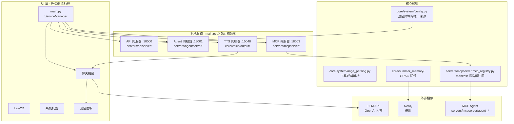

# NagaAgent

[简体中文](README.md)|[繁體中文](README_zh-Hant.md)|[English](README_en.md)


---

> ## 關於本倉庫
>
> 這是 [**RTGS2017/NagaAgent**](https://github.com/RTGS2017/NagaAgent) 的 **fork**，
> 非上游官方倉庫。原始專案版權歸原作者 **柏斯闊落** 所有，遵循倉庫內的
> [NagaAgent License](LICENSE)。
>
> **本 fork 的改動方向**（上游沒有）：介面與架構重構。
>
> | 方向 | 內容 |
> |---|---|
> | 主題系統 | `ui/styles/tokens.py` 統一色值，兩套主題：少女前線·戰術（深）/ 萊茵生命·檔案（淺） |
> | 設定頁 | 宣告式重寫（`ui/pages/settings/`）：`schema.py` 一行宣告 = 一個設定項，UI 自動生成 |
> | 聊天控制器 | 967 行單一類拆成 3 個 mixin（列表 / 串流 / 表情）+ 編排主類 |
> | 視覺 | 頂欄、頁尾、訊息卡片、Live2D 設定彈窗全部重繪，直角化設計 |
> | 工程 | `scripts/audit.py` 專案健檢、`faulthandler` 崩潰日誌、連接埠從 8000 段遷至 18000 段 |
>
> **同步上游**：
> ```bash
> git remote add upstream https://github.com/RTGS2017/NagaAgent.git
> git fetch upstream && git merge upstream/main
> ```
>
> 改動集中在 `ui/` 與少量 `core/`，同步上游時衝突面主要在 `ui/`。

> **這是一個開發者工具** 需要你自己具備 Python 3.11 環境與命令列基礎
> 本專案不提供圖形化安裝包或整合包 <del>（等我有時間再弄這種東西）</del>

## 目錄

- [介紹](#介紹)
- [系統架構](#系統架構)
  - [服務與埠](#服務與埠)
  - [對話與工具呼叫](#對話與工具呼叫)
  - [執行期診斷](#執行期診斷)
- [部署執行](#部署執行)
  - [環境需求](#環境需求)
  - [1. 安裝相依套件](#1-安裝相依套件)
  - [2. 設定](#2-設定)
  - [3. 啟動](#3-啟動)
- [疑難排解](#疑難排解)
  - [埠起不來但 netstat 看不到佔用](#埠起不來但-netstat-看不到佔用)
- [相依說明](#相依說明)
- [授權條款](#授權條款)
- [貢獻](#貢獻)

## 介紹

NagaAgent 是一個基於 PyQt5 的桌面智慧對話助手，圍繞四個本地服務 + 一套 MCP 工具展開：

- **串流對話**：LLM 串流輸出，**模型自行呼叫工具**（原生 function calling）
- **MCP 工具系統**：以 `agent-manifest.json` 宣告式註冊，行程內排程
- **知識圖譜記憶（GRAG）**：五元組抽取與檢索，預設 Kuzu 嵌入式後端，無需額外服務
- **即時語音**：語音輸入 + TTS 輸出
- **桌面形態**：Live2D 虛擬形象、系統托盤、設定面板

---

## 系統架構



### 服務與埠

埠**全部來自 `config.json`**，由 `core/system/config.py` 統一解析：

| 服務 | 埠 | 設定節 | 程式位置 |
|---|---|---|---|
| API 伺服器 | 18000 | `api_server.port` | `servers/apiserver/api_server.py` |
| Agent 伺服器 | 18001 | `agentserver.port` | `servers/agentserver/agent_server.py` |
| MCP 伺服器 | 18003 | `mcpserver.port` | `servers/mcpserver/mcp_server.py` |
| TTS 伺服器 | 15048 | `tts.port` | `core/voice/output/server.py` |
| ASR 伺服器 | 15060 | `asr.port` | 語音輸入 |

> 讀取方式統一為 `system.config.get_current_port("<name>")`，預設值僅作後備

---

### 對話與工具呼叫

```
使用者訊息 → 帶工具定義呼叫模型
           ├ 沒有 tool_calls → 結束，內容串流回傳
           └ 有 tool_calls   → 執行工具 → 結果塞回對話 → 再呼叫模型（最多 5 輪）
```

工具定義由 `servers/apiserver/tool_schemas.py` 從
`servers/mcpserver/*/agent-manifest.json` 產生

| 能力 | 開關 | 預設 |
|---|---|---|
| 模型自行呼叫工具 | `api.function_calling_enabled` | 開 |
| 長對話自動壓縮 | 自動（超過 10 萬 token） | 開 |
| 工具路由 | `api.intent_router_enabled` | 關 |

關閉、無 MCP 服務或工具表建置失敗時，自動退回單輪串流對話

### 執行期診斷

`system_checker.py` 檢查能否啟動；`health_check.py` 檢查各服務是否連通

```bash
python -m core.system.health_check      # 非全綠時結束碼 1
curl http://127.0.0.1:18000/health/full  # 單次 2–3 秒
```

啟動後由背景執行緒延遲 6 秒執行一次，只寫日誌

## 部署執行

### 環境需求

- Python **3.11**（`>=3.11,<3.12`）
- 推薦使用 [uv](https://docs.astral.sh/uv/) 管理相依套件

### 1. 安裝相依套件

```bash
uv sync
```

也可以用指令稿或手動安裝：

```bash
python scripts/setup.py         # 跨平台；Windows 用 scripts\setup.bat
python -m venv .venv            # 手動
.\.venv\Scripts\activate
pip install -r requirements.txt
```

> 網路較慢時建議使用鏡像來源：
> `set UV_DEFAULT_INDEX=https://pypi.tuna.tsinghua.edu.cn/simple`

> **瀏覽器類 Agent 需要額外下載 Chromium**（約 150 MB）：
> `uv run playwright install chromium`
> 不做這一步不影響主程式啟動，只是「網頁解析 / 瀏覽器 Agent」不可用。

### 2. 設定

複製範本，填入你的 API Key：

```bash
cp config.json.example config.json      # Windows: copy config.json.example config.json
```

```json
{
  "api": {
    "api_key": "你的api_key",
    "base_url": "https://api.deepseek.com",
    "model": "deepseek-flash"
  }
}
```

**其餘設定項目範本裡都有行內註解**，按需修改即可，常用幾項：

| 設定項目 | 說明 |
|---|---|
| `grag.graph_backend` | `kuzu`（預設，零相依）/ `neo4j` / `sqlite` |
| `live2d.enabled` | 是否顯示 Live2D 虛擬形象 |
| `system.voice_enabled` | 是否啟用語音朗讀 |
| `ui.font_family` | 聊天字體（須為系統已安裝的字體） |

也可以在應用內的**設定面板**修改，儲存後寫回 `config.json`

> ⚠️ Kuzu 是**單寫入者**模型：**不要同時執行兩個 NagaAgent 實例**

> 知識圖譜資料預設存在 `data/graph.kuzu`，**刪除該檔案即可清空全部記憶**
> 想換位置就改 `grag.kuzu_db_path`

> ⚠️ 填好 API Key 的 `config.json` 不要分享或提交到公開倉庫 —— 它等同於你的帳戶憑證

#### 使用獨立的 Neo4j（選用）

本機已有 Neo4j 實例時：

```json
{
  "grag": {
    "enabled": true,
    "graph_backend": "neo4j",
    "neo4j_uri": "neo4j://127.0.0.1:7687",
    "neo4j_user": "neo4j",
    "neo4j_password": "你的密碼"
  }
}
```

### 3. 啟動

```bash
python main.py
```

或使用指令稿：`scripts\start.bat`（Windows）/ `./scripts/start.sh`（Linux / macOS）

啟動後四個服務分別在 18000 / 18001 / 18003 / 15048 埠，可改 `config.json` 中對應節

#### 命令列參數

```bash
python main.py --check-env --force-check   # 完整環境檢測
python main.py --quick-check               # 快速檢測
python main.py --check-api                 # 只校驗 API Key / 端點 / 模型
```

---

## 疑難排解

**先跑一次診斷**，它會逐項探活服務埠、檢查相依與目錄可寫性，
大多數「跑起來了但某功能不工作」的問題能直接定位：

```bash
python -m core.system.health_check        # 或 curl http://127.0.0.1:18000/health/full
```

| 現象 | 處理 |
|---|---|
| Python 版本不符 | 確認使用 Python 3.11 |
| 提示 API Key 無效(401) | 修改 `config.json` 的 `api.api_key`；用 `python main.py --check-api` 校驗 |
| 埠被佔用 | 檢查 18000 / 18001 / 18003 / 15048，或在 `config.json` 中改埠 |
| 提示「Kuzu 資料庫被佔用」 | 確認沒有第二個 NagaAgent 實例在執行 |
| 記憶時有時無 | 見上一條；或把 `grag.graph_backend` 設為 `sqlite` |
| Neo4j 連線失敗 | 僅在 `graph_backend` 設為 `neo4j` 時相關；改回 `kuzu` 即可免服務 |
| 瀏覽器 Agent 無法使用 | 該功能需另外安裝 SDK 與 Chromium，見下方相依說明 |
| **提示端口被占用，但 `netstat` 查不到任何占用** | Windows 保留段问题，见下方说明 |

---

### 埠起不來但 netstat 看不到佔用

Windows 上 Hyper-V / WSL / Docker 的 `winnat` 服務會**隨機保留若干埠段**
落在保留段裡的埠，普通程式**無法綁定**，會報 `WinError 10013`，
而且 `netstat` 裡看不到任何套接字 —— 表現為「埠明明是空閒的卻起不來」
保留段每次重啟會重新隨機，所以這個問題是**間歇性**的

查目前保留段：

```bat
netsh int ipv4 show excludedportrange protocol=tcp
```

臨時修復（需系統管理員權限）：

```bat
net stop winnat
:: 啟動 NagaAgent
net start winnat

:: 或永久把埠排除出動態分配
netsh int ipv4 add excludedportrange protocol=tcp startport=15048 numberofports=1 store=persistent
```

## 相依說明

相依套件全部在 `pyproject.toml` / `requirements.txt` 中直接宣告：

| 類別 | 套件 |
|---|---|
| 桌面介面 | `PyQt5` |
| 模型呼叫 | `openai`、`requests`、`aiohttp` |
| 服務框架 | `fastapi`、`uvicorn`、`mcp` |
| 設定校驗 | `pydantic`、`PyYAML` |
| 圖儲存 | `kuzu`（預設後端）；`py2neo` / `neo4j`（僅 neo4j 後端需要） |
| 語音 / Live2D | `live2d-py`、`sounddevice`、`onnxruntime` |
| 瀏覽器自動化 | `playwright`、`crawl4ai` |

> **瀏覽器主 Agent 的完整能力需要額外安裝**：`agent_playwright_master/playwright.py`
> 依賴 OpenAI Agents SDK（`openai-agents`），而它要求的 `openai>=3.0.0` 與
> `langchain-openai` 的 `openai<3.0.0` 衝突，因此不在預設相依中
> 需要時單獨安裝，並執行 `playwright install chromium`

---

## 授權條款

[NagaAgent License](LICENSE)

## 貢獻

歡迎建立 Issue 和 Pull Request
